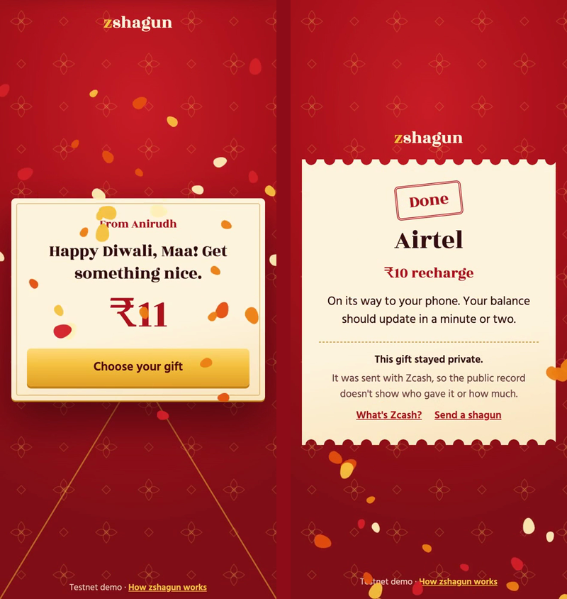

# zshagun

> zshagun lets you send a private gift from shielded Zcash as a link: the person opens it, picks a phone recharge or gift card, and gets it in seconds, with no wallet, no app and no account.

| | |
|---|---|
| **Track** | Both: Privacy, and Agentic Commerce |
| **Privacy theme(s)** | 2. The first five minutes; 1. Private payment rails |
| **Lane** | 2 (Gift on claim) and 5 (Private by default) |
| **What it is** | Web app and agent |
| **Live URL** | https://cryppit.github.io/zshagun/ |
| **Demo video** | https://cryppit.github.io/zshagun/demo.mp4 (2:00) |
| **Testnet txid** | `bc985a160c81f238380f9f3b8e5e2a8d20ee8cc23e143024116273081d0d06ba` · [Zexplorer](https://zexplorer.app/testnet/tx/bc985a160c81f238380f9f3b8e5e2a8d20ee8cc23e143024116273081d0d06ba) |
| **Real purchase invoice IDs** | `6f310da4-db18-4f03-9841-ae842d95f792` · `1bd45cb0-dabe-4558-a8b1-116906d67f85` · `1165078e-29a8-4fb4-adaf-19758c520514` · `836ff5d4-8bd1-49f6-8e63-880820252647` |
| **Team** | Anirudh ([@Anirudh-712](https://github.com/Anirudh-712)), solo |

---

## 1. The problem and who it's for

- **User:** people who hold shielded Zcash and want to give a small gift to someone who has never used crypto, and that someone.
- **Problem:** a shielded payment needs a wallet at both ends, and most people give up there. Bitrefill doesn't take ZEC either, so spending it means deshielding, swapping and handing over an email.
- **Evidence:** the Privacy track brief itself: "Most people give up before their first shielded payment". At the venue, people also told us they were wary of opening a gift link, because most hacks start with a link. That's why the envelope now says what it will never ask for.

In India, *shagun* is the gift of money given on occasions, in a sealed envelope. It traditionally ends in 1, so gifts here are ₹11, ₹51 or ₹101.

## 2. What it does

The giver picks an amount and an envelope, writes a note and pays from shielded Zcash. Their browser locks the note and makes a secret link. They send the link. The recipient sees a sealed envelope, taps the coin, reads the note and picks a recharge or gift card. An agent checks the live price and its limits, buys through Bitrefill from a prepaid balance, and waits until it's delivered. The giver gets a private "opened" note, and an unopened gift goes back to them.



## 3. Try it in 5 minutes

**Without installing anything:** the video shows a full real run. To see the giver's side, open https://cryppit.github.io/zshagun/, pick a coin and an envelope, write a note and tap Seal it. Paying needs an NU7 testnet wallet, and today that means a developer tool.

Real gift links aren't posted here, because each one spends real credits and works once. Judges can ask the point person for one on demo day. With a link:

1. Open it and tap the coin.
2. Pick something. A gift card needs no phone number.
3. You should see your recharge confirmed, or your card details. Save them before tapping "I've saved it".

**Run it locally, in under a minute, with nothing to install:**

```bash
git clone https://github.com/cryppit/zshagun
cd zshagun
npm test
npm run demo
```

`npm run demo` prints a gift link. The wallet and Bitrefill are stand-ins there, so it buys nothing and the code it shows isn't real. Everything else is the real code. Ports 8080 and 8791 must be free.

**Requirements:** Node 22.13 or later. There are no npm dependencies.

**The real thing, about 30 minutes,** most of it building the wallet tool:

1. Build [zcash-devtool](https://github.com/zcash/zcash-devtool) and make a testnet wallet for the agent. Put them in `SHAGUN_HOME` (default `~/fsh`) as `zcash-devtool/target/release/zcash-devtool`, `wallets/receiver` and `wallets/receiver.age`.
2. Set your agent's wallet address in `web/config.js`. Copy `.env.example` to `shagun.env`, next to the repo, and add your Bitrefill key.
3. `scripts/agent.sh dry` starts the agent on :8791, buying nothing. You should see `zshagun on :8791, dry run`.
4. To reach it from a phone, run `cloudflared tunnel --url http://localhost:8791 > ~/fsh/tunnel.log 2>&1`, then `scripts/set-tunnel.sh`, then publish `web/`.
5. `scripts/agent.sh live` buys for real, from your Bitrefill balance.

`scripts/find-products.mjs` is a read-only look at what the agent can buy today. `scripts/make-gift.mjs 11 "Happy Diwali" "Your name"` pays a gift from a second wallet and prints its link.

**Test funds:** TAZ from [Fauzec](https://fauzec.com) or [Valar](https://faucet.testnet.valargroup.dev/). Real purchases need Bitrefill credits.

## 4. What actually works

| Step in the core flow | Status | Evidence |
|---|---|---|
| Giver makes a gift: note locked in the browser, link and payment request made | ✅ real | Video 0:09 |
| Shielded payment with the gift memo, NU7 testnet, Ironwood pool | ✅ real | [`bc985a16…`](https://zexplorer.app/testnet/tx/bc985a160c81f238380f9f3b8e5e2a8d20ee8cc23e143024116273081d0d06ba), video 0:22 |
| Agent sees the memo and confirms the payment | ✅ real | One confirmation, about a minute. A watcher pass every 15 seconds |
| Recipient opens the link with no wallet, app or account | ✅ real | Video 0:31 |
| Agent finds products, reads the live price, checks limits | ✅ real | `src/finder.mjs`, `src/guard.mjs`, video 0:42 |
| Agent buys through Bitrefill and polls until delivered | ✅ real | Four invoices, below |
| Value lands | ✅ real | ₹7.47 talktime on a real SIM; Flipkart ₹50 added to a real Flipkart account |
| "Opened" memo back to the giver | ✅ real | [`efcf6b75…`](https://zexplorer.app/testnet/tx/efcf6b757ff0b573941e86afb132d644c9d73bd82755ea29beeb0c014a9d6463), video 1:16 |
| Same link twice: one gift | ✅ real | Video 1:25 |
| Refund of an unopened gift | 🟡 partial | Tested against a stand-in wallet only. No real gift has expired yet |
| Goods paid for by the gift itself | 🔴 not done | **The TAZ gift triggers the purchase but doesn't fund it.** TAZ is worthless and Bitrefill doesn't take ZEC, so the goods are paid from Bitrefill event credits |

| Real purchase | Bitrefill invoice | Result |
|---|---|---|
| Airtel ₹10 recharge | `6f310da4-db18-4f03-9841-ae842d95f792` | Delivered in 18 seconds. ₹7.47 of talktime landed on a real SIM |
| Flipkart ₹50 gift card | `1bd45cb0-dabe-4558-a8b1-116906d67f85` | Delivered in about 11 seconds, then redeemed in the Flipkart app |
| Jio 1GB data pack | `1165078e-29a8-4fb4-adaf-19758c520514` | Claimed by another hacker on his own phone, delivered in about 22 seconds |
| Airtel ₹10 recharge | `836ff5d4-8bd1-49f6-8e63-880820252647` | The purchase in the demo video, delivered in about 22 seconds |

The first purchase crashed our agent after Bitrefill had taken payment. It didn't buy twice, because a claim is recorded before buying and is never retried. `FEEDBACK.md` has the story.

**Known limitations:**

- We haven't tested with people who have never used crypto, so we make no claim about how long it takes them.
- Giving needs an NU7 testnet wallet, which today means a developer tool.
- A recipient chooses one item. If it costs less than the gift, the rest isn't kept for them: it goes back to the giver if they left a refund address.
- Carriers take fees: a ₹10 Airtel recharge added ₹7.47 of talktime.
- Only Airtel, Jio and Flipkart have been tested with real purchases. Other brands may return different fields, so the page shows every field Bitrefill sends.
- The agent runs on a quick tunnel, whose address changes on restart, which breaks claims until `web/config.js` is updated.
- One confirmation is enough to fund a gift here. Mainnet should wait for more.
- A mainnet launch needs a check of the rules on reselling gift cards in India.

## 5. Privacy and trust

1. **What stays private?** On chain, who gave, how much and the note are all in a shielded transaction. The giver's payment and the purchase share no public transaction, because the agent buys from a prepaid balance. The note, the sender's name and the envelope choice are encrypted in the browser with a key that never leaves it. Claiming sends a separate token, so the agent can't read them even then. The recipient has no wallet, app or account.
2. **What does the app reveal, and to whom?**

| Hop | Sees | Doesn't see |
|---|---|---|
| Public chain | That a shielded transaction happened | Who, how much, the note |
| Light-wallet server (testnet.zec.rocks) | The giver's and the agent's IP and sync timing | The gift |
| Page host (GitHub Pages) | Visitors' IPs | The link's secret, which stays in the URL fragment |
| The chat the link is sent in | The link. Backups, forwards and anyone holding the phone can expose it, so treat it like cash | The giver's wallet |
| Cloudflare (tunnel) | Recipient's IP, claim timing, the product chosen | The phone number, sealed in the browser. The giver's wallet |
| Agent operator (us) | Recipient's IP and phone number, amount, product, the code, refund address if given | The note, the sender's name, the giver's balance and other payments |
| Bitrefill | Our account, the product, the phone number for a recharge | The giver, the recipient's IP |
| Mobile carrier | The number got a recharge | Who paid |

A recharge names a phone number, and that's usually a real person. A gift card keeps it away from Bitrefill. The recipient usually knows who sent it. Privacy here means strangers can't see it. Phone numbers stay sealed in the ledger, and are wiped after delivery. A gift code is wiped when the recipient taps "I've saved it", or after an hour. Logs hold no IP, phone number, secret or code.

3. **Who do users have to trust?** Us as operator: we see each claim, hold the float and could fail to deliver, so this is custodial until a gift is claimed or refunded. Bitrefill to deliver, and with the phone number. Cloudflare for the tunnel, GitHub Pages to serve the page we published, and Oracle Cloud, which hosts the agent. The hosted light-wallet server. No AI model is involved in a claim, so no model provider sees anything.
4. **What would you fix next?**
   - The agent's spending key sits on the server, against the advice to keep only a viewing key there, because refunds and "opened" notes need it. A viewing-key watcher with a separate signer is the fix.
   - Refilling the float on mainnet is a public step (deshield, 1Click, USDC, Bitrefill), and a refill right after a big gift could hint at it. Refills must be batched.
   - The operator sees every claim.
   - A link is a bearer secret, and anyone could copy our page to phish. A separate PIN and a real domain would help.
   - The agent's own wallet traffic isn't hidden yet. Nym is the next step.
   - Nobody has audited this code.

**Viewing key (optional):** N/A. The agent wallet's history would show every gift's memo and refund address.

## 5b. Agentic commerce with Bitrefill

- **What the agent does on its own:** every 30 minutes it asks Bitrefill what each allowed brand sells under the cap. When a gift is claimed, it re-reads the live price, checks its limits, buys, pays from balance, polls until delivered and hands over the result. A person only picks what they want. The trigger is a shielded memo plus that tap, so this isn't lane 3.
- **Bitrefill integration:** hosted eCommerce MCP with an API key: `get-product-details`, `buy-products`, `get-invoice-by-id`, `list-invoices`, `get-balances`. See `src/bitrefill.mjs` and `src/finder.mjs`.
- **Payment method:** account balance (event credits). ZEC isn't accepted.
- **Guardrails:** at most ₹101 per purchase and ₹300 a day, at the live price, from an allowlist of brands (`catalog.json`), with a balance check. Nobody approves above that, because nothing above it happens: only the founder can change the limits, in code. Each gift buys once, recorded before buying. Live buying is off unless `SHAGUN_LIVE=1`.
- **Purchase proof:** invoice `836ff5d4-8bd1-49f6-8e63-880820252647`, video 0:42 to 1:02, and the three above.
- **What's new here:** the recipient picks the brand and the purchase happens then, with unclaimed funds going back to the giver, triggered by a shielded payment whose note the agent can't read. The prepaid float means the gift and the purchase share no public transaction.

## 6. How it's built

- **Technologies used:** Zcash NU7 testnet (Ironwood pool, unified addresses, ZIP 321 payment links, encrypted memos); zcash-devtool at `0b3436b`; testnet.zec.rocks; Bitrefill eCommerce MCP; Node 22.23 (`node:http`, `node:sqlite`, `node:test`); WebCrypto (HKDF, AES-GCM, ECDH P-256); Cloudflare quick tunnel (cloudflared 2026.10.1); GitHub Pages; [qrcode-generator](https://github.com/kazuhikoarase/qrcode-generator) 1.4.4 (MIT, in `web/vendor`); Rozha One and Hind fonts by Indian Type Foundry (SIL Open Font License, in `web/fonts`). The film's voiceover is an AI clone of the founder's own voice, made with Higgsfield.
- **Architecture:**

  ```
  [Giver's browser] -- locks note, makes link --> [Shielded payment + memo] --> [Zcash NU7 testnet]
                                                                                     |
  [Recipient's browser] -- claim token --> [Tunnel] --> [Agent: watcher, ledger, guardrails]
                                                              |
                                                              +--> [Bitrefill MCP: price, buy, poll]
  ```

- **Code worth reading:** `web/gift.js` (two keys from one secret, so claiming doesn't reveal the note), `src/ledger.mjs` (the single atomic claim), `src/server.mjs` (after a purchase, anything that goes wrong ends in "needs a human", never a retry), `src/bitrefill.mjs` (reads every redemption field, tested on real replies).
- **Built during the hack vs before:** all code was written on 4 November, from 11:00 IST. Before the hack: the idea, the plan, and tool setup (zcash-devtool built, testnet wallets made, test payments between them). None of our earlier projects' code is in this repo.
- **Reusable parts:** the gift memo and key scheme in `web/gift.js`; the guardrail module; the Bitrefill notes in `FEEDBACK.md`.

**How it works.** The link's `#fragment` holds a 32-byte secret `S`, and browsers don't send a fragment to any server. Claim token `T` = HKDF(S, "claim"), and gift id = SHA-256(T). The agent gets `T` only at claim time. The message key = HKDF(S, "message") never leaves the browser. The memo is text under 512 bytes: `SHG1|id|tier|refund address or -|locked note`.

**What stops a double purchase:** one SQL update moves a gift from `confirmed` to `claimed`, and only one caller can win it, before anything is bought. A purchase is one call and is never retried. If the agent stops after claiming and before it has an invoice, restart marks the gift "needs a human". If it already has an invoice, restart goes back to polling that invoice.

**Design decisions.**

- **The recipient needs nothing.** No wallet, app or account, and Zcash is named only after the gift arrives.
- **The secret lives in the fragment,** so servers never receive it. Sharing uses the phone's own share sheet, because a `wa.me` link would put it in a query string.
- **Two keys from one secret,** so claiming a gift doesn't hand over the note.
- **A prepaid float instead of a swap per gift.** It breaks the public link between giver and purchase, and a claim takes seconds.
- **No AI model reads claims.** The agent is rules and limits, so no model provider ever sees a phone number.
- **No third-party scripts or fonts on the page,** because it holds a secret. A Content-Security-Policy enforces that.
- **A sealed lifafa, not a dashboard.** A shagun is an envelope with a coin on it. A sealed envelope is also the plainest way to show what shielded means.
- **zcash-devtool as the wallet,** because it speaks NU7 today. It is not production software.
- **One confirmation funds a gift.** Testnet blocks average 25 seconds, and the most at risk is one capped purchase.

**Others in this space.** Crypto red-packet links aren't new. [Angpao.money](https://ethglobal.com/showcase/angpao-money-1mn7c), [HongBao](https://ethglobal.com/showcase/hongbao-oaust), [RedEnvelope](https://ethglobal.com/showcase/redenvelope-uc25t) and exchange red packets put crypto in the recipient's hands, on public chains, usually through a wallet. In Zcash, ZecLink and ZIP 324 links deliver ZEC. zshagun differs in two ways: the recipient gets a recharge or gift card and never holds crypto, and the payment is shielded.

## 7. What's next (30 days)

- **Next milestone:** a real domain, face-to-face QR codes, and a giver path that doesn't need a developer wallet, starting with the Noir Wallet testnet build if it works on NU7. By 4 December.
- **Who benefits:** first-time recipients, and Zcash meetups giving out small gifts.
- **Then:** a viewing-key watcher with the signing key off the server, and letting a recipient spend a gift's full value.
- **Already started:** this repo, `FEEDBACK.md` for Bitrefill and Zcash, and a zcash-devtool bug report.

## 8. Links

- Repo: https://github.com/cryppit/zshagun
- Demo video: https://cryppit.github.io/zshagun/demo.mp4
- Live app: https://cryppit.github.io/zshagun/

## Feedback

See `FEEDBACK.md`: what broke, confused or slowed us down, for Bitrefill and for Zcash.

## License

MIT. See `LICENSE`.

zshagun is an independent project. It isn't made, endorsed or sponsored by the Zcash Foundation, Electric Coin Company or Bitrefill. Zcash is a trademark of its owners.

## Resources used

- Privacy track brief: https://stadium.joinwebzero.com/programs/free-society-hack-2026/privacy/llms.txt
- Agentic Commerce track brief: https://stadium.joinwebzero.com/programs/free-society-hack-2026/agentic-commerce/llms.txt
- Testnet faucets: https://fauzec.com · https://faucet.testnet.valargroup.dev/
- Testnet explorer: https://zexplorer.app
- Bitrefill docs: https://docs.bitrefill.com
